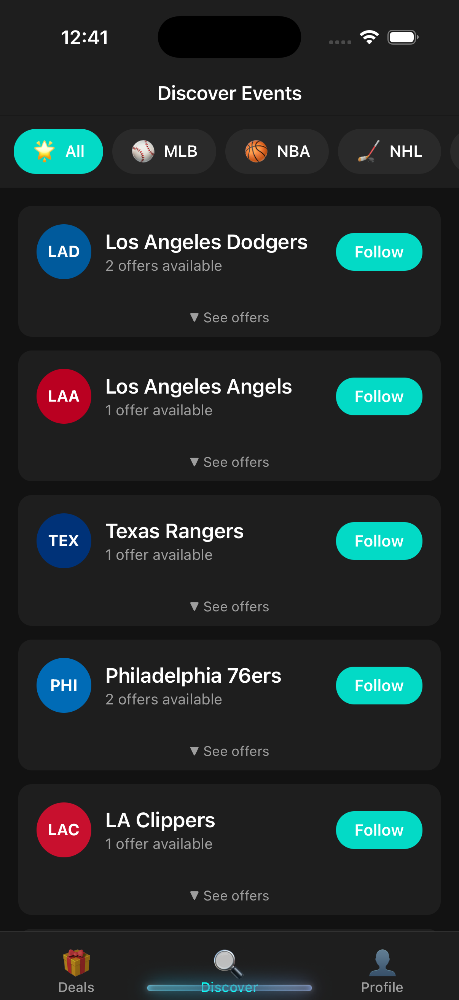
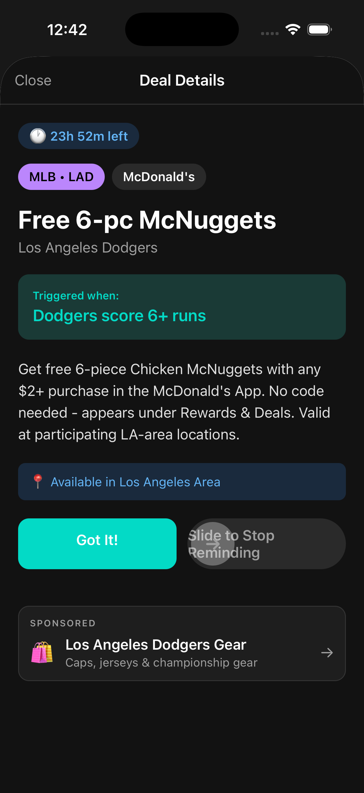
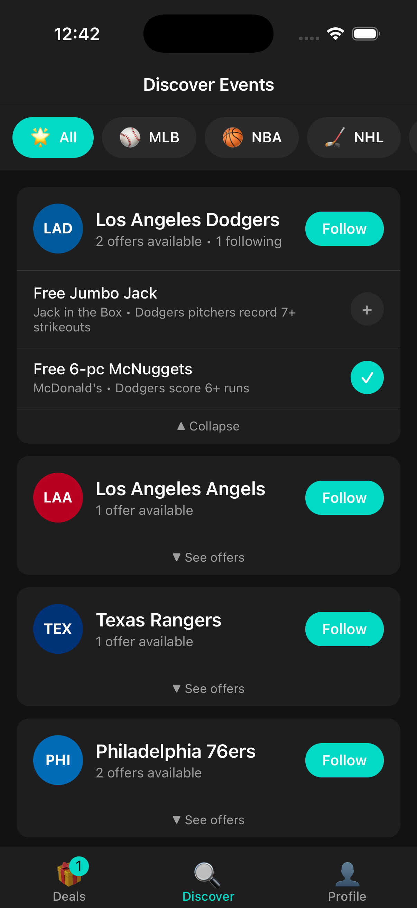
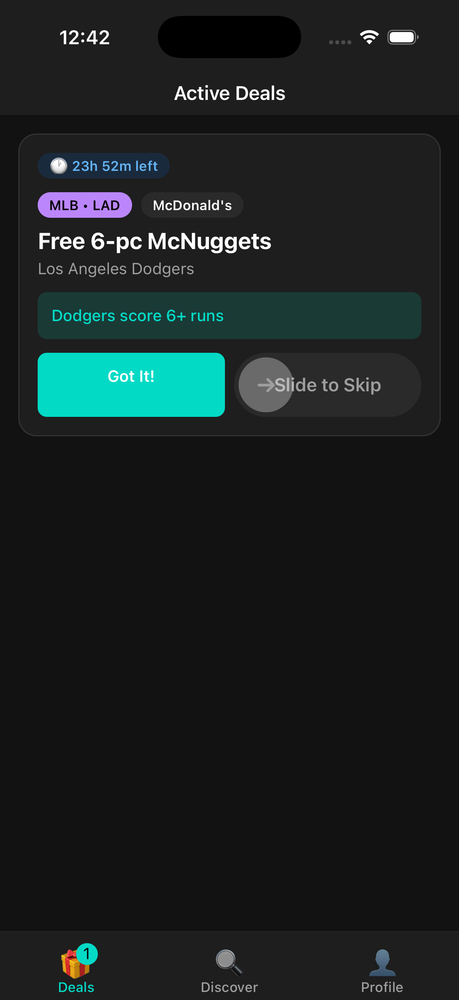
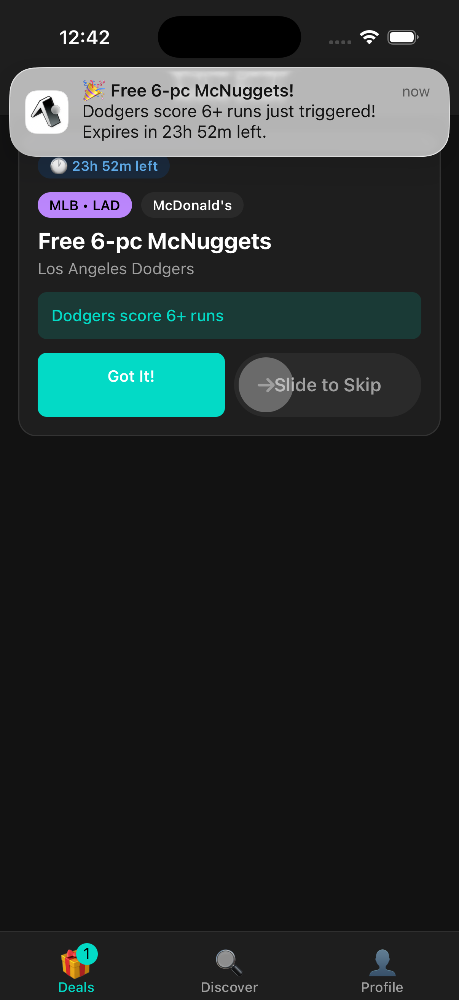

# Freebies

Get notified about free offers when your favorite sports teams win or hit milestones.

## Screenshots

<table align="center">
  <tr>
    <td align="center" width="20%"></td>
    <td align="center" width="20%"></td>
    <td align="center" width="20%"></td>
    <td align="center" width="20%"></td>
    <td align="center" width="20%"></td>
  </tr>
  <tr>
    <td align="center">Discover</td>
    <td align="center">Deal details</td>
    <td align="center">My deals</td>
    <td align="center">Active deal</td>
    <td align="center">Notification</td>
  </tr>
</table>

## Components

- [Mobile app](apps/mobile/): React Native app built with Expo.
- [API](services/api/): Go server for leagues, offers, subscriptions, and push notifications.
- [Scheduler](services/scheduler/): Go CronJob that polls live games and triggers deals.

## Documentation

- [Development guide](docs/development.md)
- [Contributing](docs/contributing.md)
- [Architecture](docs/architecture.md)
- [Operations](docs/operations.md)
- Mobile: [architecture](apps/mobile/docs/architecture.md),
  [development](apps/mobile/docs/development.md), [App Store checklist](apps/mobile/APP-STORE.md),
  [privacy policy](apps/mobile/PRIVACY-POLICY.md)
- API: [architecture](services/api/docs/architecture.md),
  [development](services/api/docs/development.md), [API reference](services/api/docs/api.md),
  [CLI reference](services/api/docs/cli.md), [deployment](services/api/docs/deployment.md)

## License

The [MIT](LICENSE) License.
