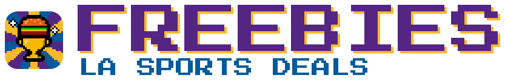
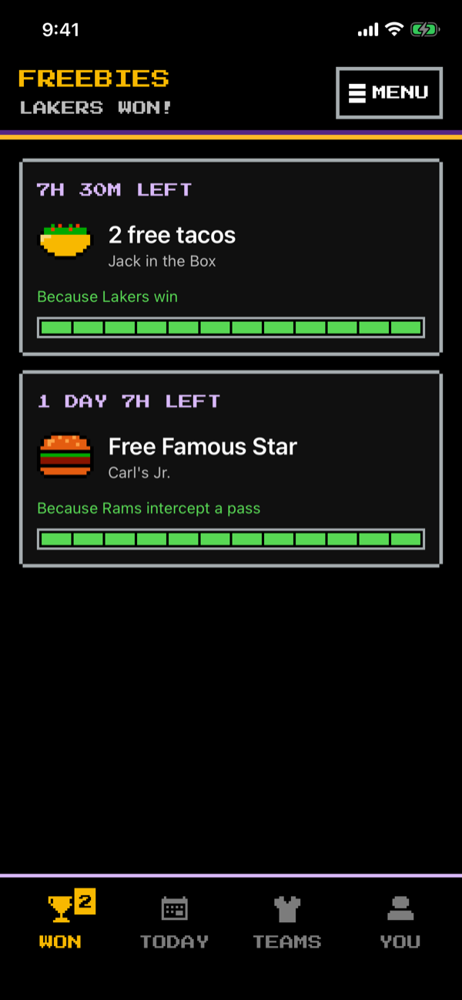
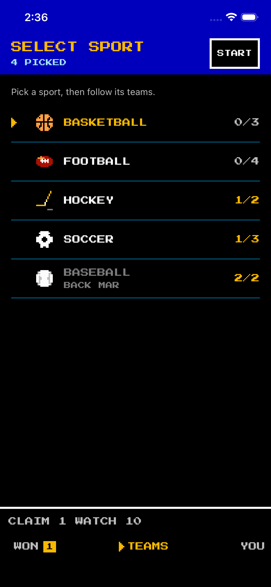
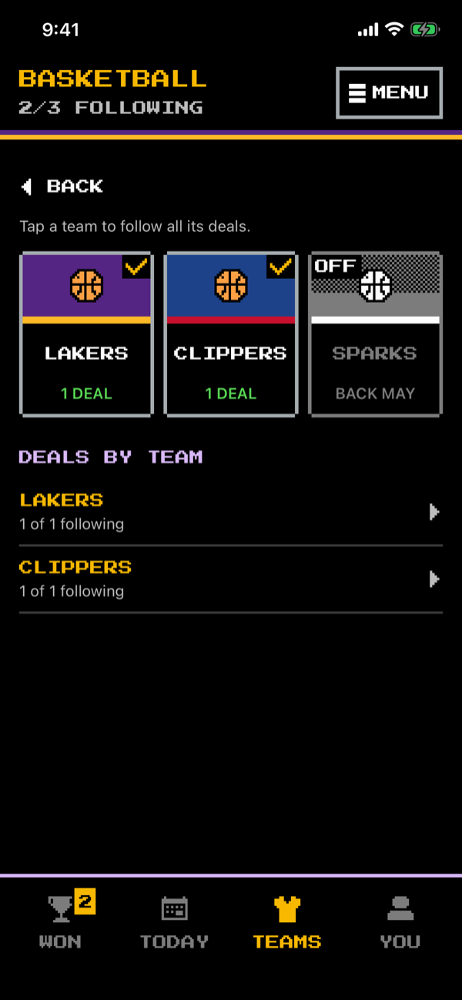
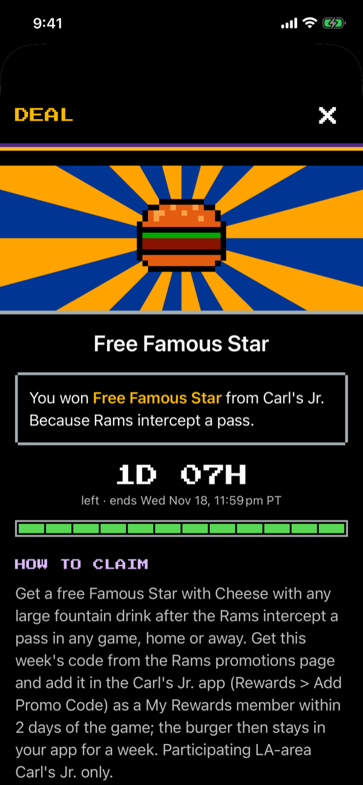

<p align="center">
  <picture>
    <source srcset="asset/logo-dark.svg" media="(prefers-color-scheme: dark)">
    <source srcset="asset/logo-light.svg" media="(prefers-color-scheme: light)">
    
  </picture>
</p>

<p align="center">When LA wins, you win.</p>

<p align="center">
  <a href="LICENSE"></a>
  <a href="https://go.dev"></a>
  <a href="https://expo.dev"></a>
  
  <a href="https://conventionalcommits.org"></a>
  <a href="https://just.systems"></a>
  <a href="https://github.com/tekk/hovnokod-badge"></a>
</p>

I built this for myself because LA restaurants give away food when LA teams win, and I kept finding
out after the deal had expired. The app watches the games for the teams I follow and sends a push
the moment a deal unlocks, with where to claim it and when it ends.

<table align="center">
  <tr>
    <td align="center" width="50%"><a href="asset/screenshots/won.png"></a></td>
    <td align="center" width="50%"><a href="asset/screenshots/select-sport.png"></a></td>
  </tr>
  <tr>
    <td align="center"><sub>Won</sub></td>
    <td align="center"><sub>Select sport</sub></td>
  </tr>
  <tr>
    <td align="center" width="50%"><a href="asset/screenshots/teams.png"></a></td>
    <td align="center" width="50%"><a href="asset/screenshots/deal.png"></a></td>
  </tr>
  <tr>
    <td align="center"><sub>Teams</sub></td>
    <td align="center"><sub>Deal unlocked</sub></td>
  </tr>
</table>

## Features

| Feature              | What it does                                                                                   |
| -------------------- | ---------------------------------------------------------------------------------------------- |
| LA teams only        | Follow LA and Orange County teams; every deal is tied to one of them.                          |
| Game-triggered deals | A Ducks home win, 7+ Dodgers strikeouts or 5+ Angels runs at home unlocks food from a sponsor. |
| Push alerts          | A notification arrives when a deal unlocks, with where to claim it and when it ends.           |
| Verified deals       | A deal goes live only after it is checked on the sponsor's or team's own page.                 |
| Pause alerts         | Mute pushes for a while without unfollowing your teams.                                        |
| 8-bit look           | Pixel sprites and a retro palette, built for touch, screen readers and reduced motion.         |
| Server-driven        | New deals, teams, seasons and sprites reach the app from the API, without an app release.      |

Freebies: LA Sports Deals is not affiliated with, endorsed by or sponsored by any team, league,
school or restaurant.

## Quickstart

Run from a checkout. Requires [mise](https://mise.jdx.dev), which installs Go, Node, Bun and
[just](https://just.systems).

```sh
mise install
just setup        # first time: install the app's dependencies
just api-serve    # API on :8080; migrates the database
just mobile-serve # Expo dev server, in a second terminal
```

Press `i` in the Expo terminal to open the iOS simulator.

## Skills

Every workflow lives in a [Claude skill](https://agentskills.io) under `.claude/skills/`; people can
read them too. [ops](.claude/skills/ops/SKILL.md) sets up, runs and tests the API and the app, adds
deals, deploys the backend and releases iOS. [design](.claude/skills/design/SKILL.md) builds and
reviews 8-bit screens and draws and ships pixel sprites.

## Contributing

See [CONTRIBUTING.md](CONTRIBUTING.md) for development, testing and releases.

## License

[MIT](LICENSE)
